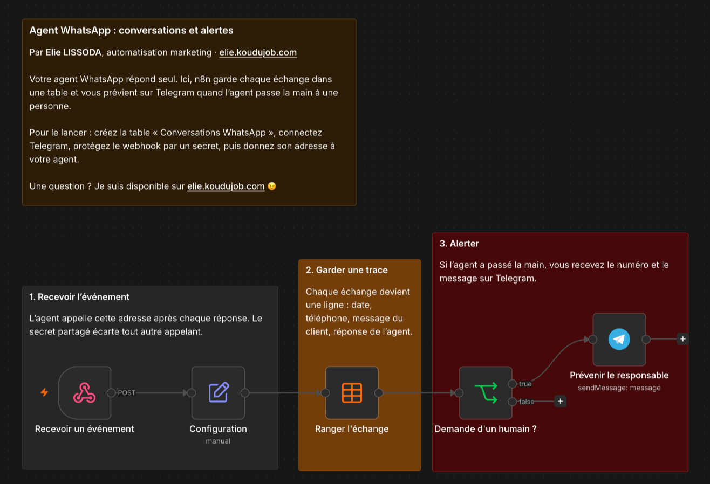

# Agent WhatsApp : conversations et alertes

Votre agent WhatsApp répond seul. Ici, n8n garde chaque échange dans une table et vous prévient sur Telegram quand l'agent passe la main à une personne.

## Comment il fonctionne

1. **Recevoir l'événement.** L'agent appelle cette adresse après chaque réponse. Le secret partagé écarte tout autre appelant.
2. **Garder une trace.** Chaque échange devient une ligne : date, téléphone, message du client, réponse de l'agent.
3. **Alerter.** Si l'agent a passé la main, vous recevez le numéro et le message sur Telegram.

Testé sur mon instance avec les deux événements envoyés par le kit : chaque échange est devenu une ligne de la table, et la demande d'un humain a déclenché l'alerte Telegram. Le secret partagé du webhook, lui, reste à essayer.

## Pour l'installer

1. Créez la table n8n « Conversations WhatsApp » avec les colonnes recu_le (date), evenement, telephone, message_client, reponse_agent (texte) et pause_heures (nombre).
2. Créez un identifiant « Header Auth » : nom `X-AgentKit-Secret`, valeur au choix. Choisissez-le dans le nœud « Recevoir un événement ».
3. Créez votre identifiant Telegram, puis dans Configuration renseignez `telegram_chat_id`.
4. Importez `workflow.json`, choisissez votre table, puis publiez le workflow.
5. Dans le `.env` de votre agent [WhatsApp AgentKit](https://github.com/Elie-Ander/whatsapp-agentkit-fr), collez l'adresse de production du webhook dans `N8N_WEBHOOK_URL` et votre valeur secrète dans `N8N_WEBHOOK_SECRET`.

Si votre agent vous alerte déjà lui-même sur Telegram, désactivez le nœud « Prévenir le responsable » pour ne pas recevoir l'alerte en double.

---

Un souci pour l'installer, ou une question ? Je suis disponible sur [elie.koudujob.com](https://elie.koudujob.com) 😉

**Elie LISSODA**
