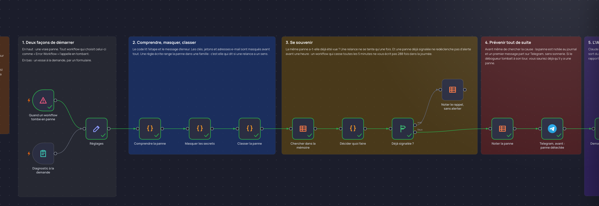

# Débogueur automatique

Un workflow qui casse à 5 heures du matin ne prévient personne. Celui-ci vous écrit sur Telegram dès la panne, relance tout seul ce qui est passager, puis vous dit si c'est réparé ou quoi corriger.

## Comment il fonctionne

1. **Deux façons de démarrer.** Une vraie panne : tout workflow qui choisit celui-ci comme « Error workflow » l'appelle en tombant. Ou un essai à la demande, par un formulaire.
2. **Comprendre, masquer, classer.** Le code lit l'étape et le message d'erreur. Les clés, jetons et adresses e-mail sont masqués avant tout. Une règle écrite range la panne dans une famille : c'est elle qui dit si une relance a un sens.
3. **Se souvenir.** Une relance ne se tente qu'une fois. Une panne déjà signalée ne redéclenche pas d'alerte avant une heure.
4. **Prévenir tout de suite.** Avant même de chercher la cause, la panne est notée au journal et un premier message part sur Telegram, sans sonnerie.
5. **L'IA explique, le code vérifie.** Claude rédige la cause et la correction à partir des faits masqués. Si sa réponse sort du cadre, ou s'il ne répond pas, les règles écrites prennent le relais : le rapport sort toujours.
6. **Réparer ce qui peut l'être.** Une panne passagère sur un workflow que vous avez inscrit est relancée par l'API de n8n. Les autres ne sont jamais relancés seuls : un envoi ou un paiement pourrait partir deux fois.
7. **Tracer et annoncer le résultat.** Le journal reçoit la conclusion, puis un second message part sur Telegram. Réparé tout seul : sans sonnerie. Une personne doit agir : avec sonnerie, et des boutons pour décider.
8. **Corriger, pour que ça ne revienne pas.** Pour une panne passagère, une correction simple est prête, choisie par une règle écrite. Vous la publiez d'un bouton. L'IA explique la panne, elle ne choisit jamais la correction.
9. **Rapport à l'écran.** Seulement pour un diagnostic lancé à la demande, par le formulaire.

Testé sur des pannes provoquées : service indisponible, accès refusé, donnée manquante.

## Pour l'installer

1. Créez un identifiant Telegram, un identifiant Anthropic, et une clé dans Settings, n8n API, pour la relance.
2. Dans Réglages, indiquez votre identifiant de conversation Telegram, l'adresse de votre n8n, et les workflows que vous autorisez à être relancés ou corrigés.
3. Créez la table n8n « Journal du débogueur » avec les colonnes quand, workflow, workflow_id, execution_id, etape, message, famille, origine, etat, action, cause, correction, analyse, confiance, verification, deja_vue, relance_id, duree_s, cle.
4. Importez `workflow.json`, choisissez votre table et activez le workflow. Dans les réglages de chaque workflow à surveiller, choisissez-le comme « Error workflow ».

À savoir : l'étape « Corriger sans attendre » appelle un second workflow, celui qui exécute ce que vous décidez depuis les boutons Telegram. Il n'est pas encore dans ce dossier. Sans lui, le débogueur diagnostique, relance et vous prévient. Les boutons, eux, n'agissent pas.

La clé et l'adresse e-mail des pannes d'essai sont fictives : elles servent à montrer le masquage.

---

Un souci pour l'installer, ou une question ? Je suis disponible sur [elie.koudujob.com](https://elie.koudujob.com) 😉

**Elie LISSODA**
