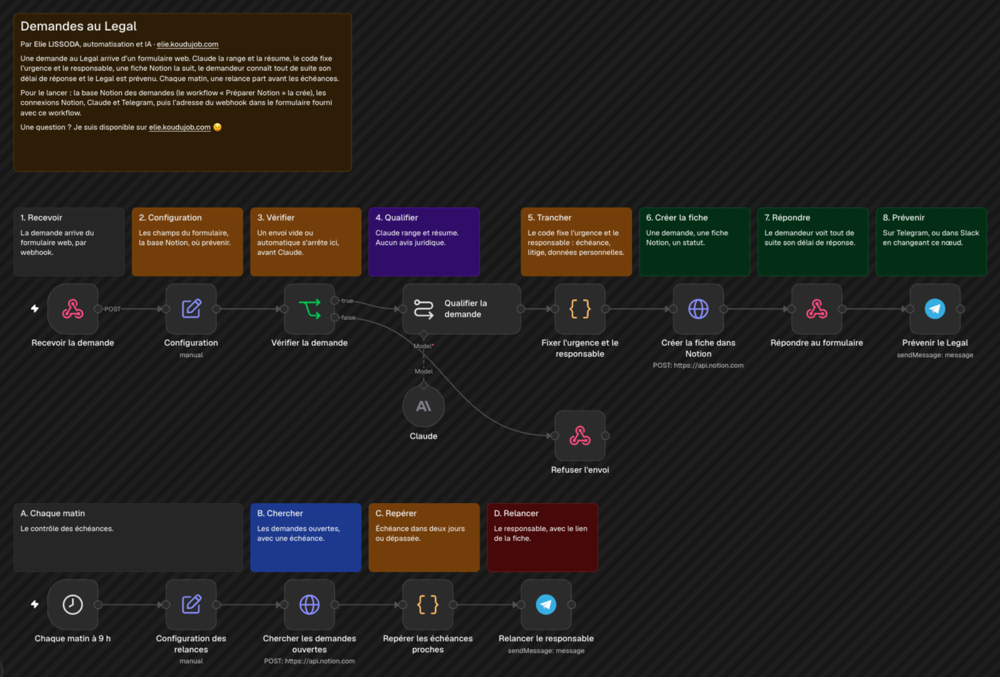

# Demandes au Legal

Les questions au Legal arrivent par Slack, par mail, entre deux portes. Ce workflow les fait passer par un seul formulaire : chaque demande est classée, résumée et suivie, et le demandeur sait tout de suite sous quel délai il aura sa réponse.

**Essayer le formulaire :** [elie.koudujob.com/demos/legal](https://elie.koudujob.com/demos/legal/) (données fictives uniquement).

## Comment il fonctionne

1. **La demande arrive.** Depuis le formulaire fourni dans `formulaire/` : prénom, équipe, demande, échéance, lien vers le document.
2. **Vérifier.** Un envoi vide ou rempli par un robot s'arrête là, avant tout appel à Claude.
3. **Qualifier.** Claude range la demande dans l'un des six types (contrat client, contrat fournisseur, contrat de travail, données personnelles, litige, question simple), lui donne un titre court et note ce qui manque pour la traiter. Il ne donne aucun avis juridique.
4. **Trancher.** Le code, pas l'IA, fixe l'urgence et le responsable avec des règles lisibles : un litige ou une échéance à deux jours passe en urgence haute, réponse sous 24 heures. Les données personnelles et les contrats de travail passent en urgence moyenne.
5. **Suivre.** Une fiche Notion par demande : type, urgence, responsable, échéance, statut.
6. **Répondre.** Le formulaire affiche au demandeur son délai, son responsable et ce qu'il peut envoyer pour aller plus vite.
7. **Prévenir.** Le Legal reçoit l'alerte sur Telegram, avec le lien de la fiche.
8. **Relancer.** Chaque matin à 9 h, une demande ouverte dont l'échéance tombe dans les deux jours, ou est dépassée, déclenche une relance au responsable.

Testé avec des demandes fictives envoyées depuis le formulaire : fiche Notion, alerte et réponse affichée en moins de 10 secondes.

## Pour l'installer

1. Créez un identifiant Notion (intégration interne), un identifiant Anthropic et un identifiant Telegram.
2. Importez `preparer-notion.workflow.json`. Partagez une page Notion avec votre intégration, collez son identifiant dans Configuration et lancez-le une fois : il crée la base « Demandes au Legal ».
3. Importez `workflow.json`. Dans Configuration, collez l'identifiant de la base et votre identifiant de conversation Telegram. Faites de même dans « Configuration des relances ».
4. Dans « Recevoir la demande », remplacez `https://votre-site.fr` par l'adresse du site qui hébergera le formulaire, puis publiez le workflow.
5. Dans `formulaire/index.html`, remplacez `https://VOTRE-N8N/webhook/demande-legal` par l'adresse de production du webhook, puis mettez la page en ligne.

Chaque demande consomme un appel à Claude, facturé sur votre compte Anthropic. Pour prévenir le Legal dans Slack, remplacez les deux nœuds Telegram.

---

Un souci pour l'installer, ou une question ? Je suis disponible sur [elie.koudujob.com](https://elie.koudujob.com) 😉

**Elie LISSODA**
