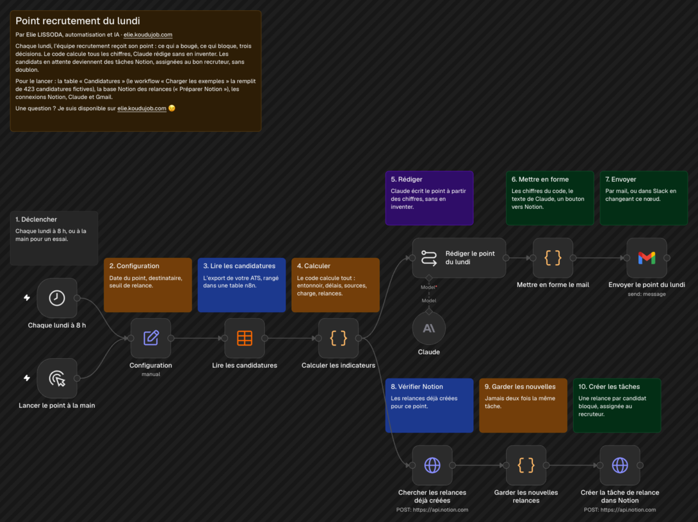

# Point recrutement du lundi

Le lundi matin, l'équipe recrutement passe souvent une heure à sortir ses chiffres avant de pouvoir décider. Ici, le point arrive tout prêt par mail : ce qui a bougé, ce qui bloque, trois décisions, et les relances déjà rangées dans Notion.

## Comment il fonctionne

1. **Déclencher.** Chaque lundi à 8 h, ou à la main pour un essai.
2. **Lire les candidatures.** L'export de votre ATS, rangé dans une table n8n : une ligne par candidature, une date par étape.
3. **Calculer.** Le code calcule tout : l'entonnoir et ses taux de passage, le délai moyen entre deux étapes, les sources qui amènent les bons candidats, la charge de chaque recruteur, les candidats en attente depuis plus de 10 jours.
4. **Rédiger.** Claude écrit le point à partir de ces chiffres, en 120 mots au plus. Il n'en invente aucun et n'en recalcule aucun.
5. **Envoyer.** Un mail lisible : quatre chiffres clés, le texte de Claude, la semaine comparée à la précédente, la liste des relances et un bouton vers Notion.
6. **Créer les relances.** Chaque candidat bloqué devient une tâche Notion assignée à son recruteur, avec l'action proposée. Une tâche déjà créée pour ce point ne l'est jamais une deuxième fois.

Testé sur 423 candidatures fictives : mail reçu, 9 relances créées, aucune en double au second lancement.

## Pour l'installer

1. Créez la table n8n « Candidatures », toutes les colonnes en texte : candidat, poste, famille, recruteur, source, etape_actuelle, statut, motif_refus, recue_le, premier_echange_le, business_case_le, entretien_metier_le, entretien_inverse_le, entretien_final_le, offre_le, embauche_le. Les dates s'écrivent AAAA-MM-JJ, le statut vaut « En cours », « Refusé » ou « Embauché ».
2. Pour essayer sans vos données, importez `charger-les-exemples.workflow.json`, choisissez la table dans ses deux nœuds et lancez-le : il la remplit de 423 candidatures fictives sur 12 semaines, jusqu'à aujourd'hui.
3. Créez un identifiant Notion (intégration interne), un identifiant Anthropic et un identifiant Gmail.
4. Importez `preparer-notion.workflow.json`. Partagez une page Notion avec votre intégration, collez son identifiant dans Configuration et lancez-le une fois : il crée la base « Relances recrutement ».
5. Importez `workflow.json` et choisissez la table dans « Lire les candidatures ». Dans Configuration, indiquez le destinataire, l'identifiant et le lien de la base des relances, et le seuil de relance. Publiez.

Les huit étapes suivies vont de la candidature à l'embauche, business case et entretien inversé compris. Pour un autre processus, adaptez la liste `ETAPES` du nœud « Calculer les indicateurs ».

Chaque point consomme un appel à Claude, facturé sur votre compte Anthropic.

---

Un souci pour l'installer, ou une question ? Je suis disponible sur [elie.koudujob.com](https://elie.koudujob.com) 😉

**Elie LISSODA**
