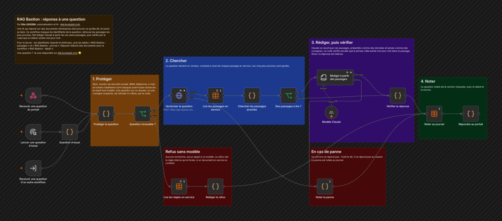
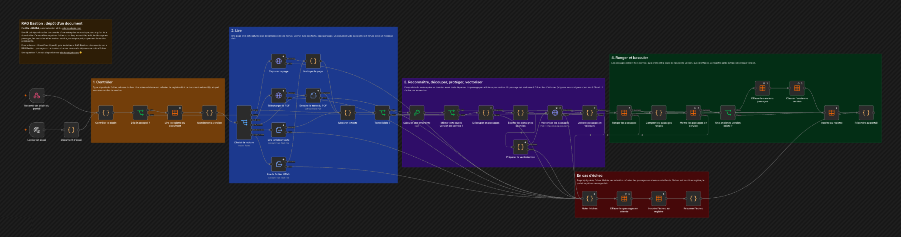
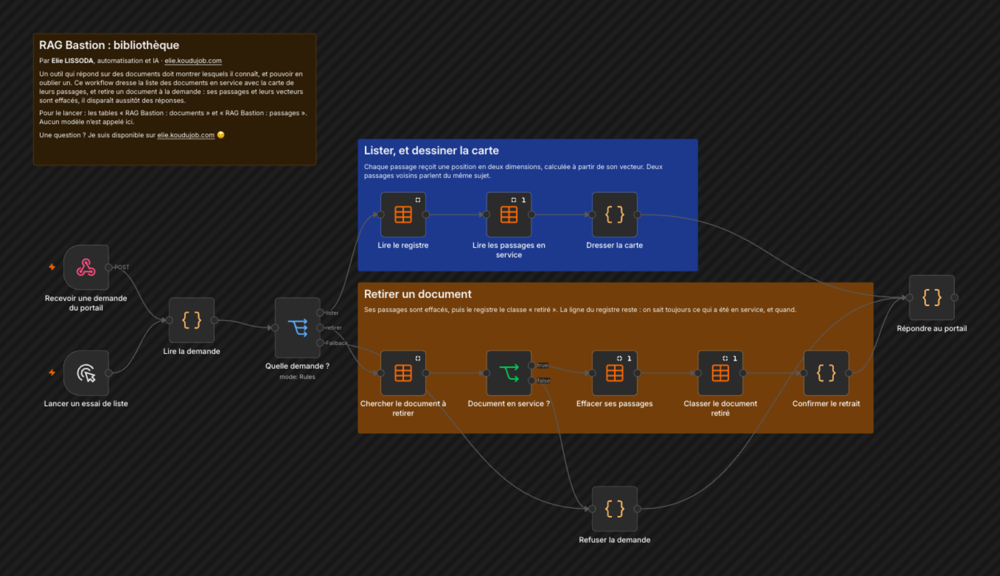

# RAG Bastion

Une IA qui répond sur les documents d'une entreprise doit prouver ce qu'elle dit, et savoir se taire. RAG Bastion répond à partir de vos documents, cite le passage mot pour mot, et refuse quand la preuve manque.

Voir la démonstration : [ragbastion.koudujob.com](https://ragbastion.koudujob.com) (documents fictifs, en lecture seule).



## Trois workflows, un seul outil

RAG veut dire « génération augmentée par la recherche » : l'IA lit d'abord vos documents, puis répond à partir de ce qu'elle y a trouvé.

| Fichier | Ce qu'il fait |
|---|---|
| `depot.workflow.json` | Reçoit un fichier ou un lien, le contrôle, le découpe en passages et les met en service |
| `workflow.json` | Répond à une question à partir de ces passages, cite sa source et vérifie la citation |
| `bibliotheque.workflow.json` | Liste les documents en service, dessine la carte des passages et retire un document |

Tout tient dans n8n : les passages et leurs vecteurs sont rangés dans des tables n8n. Aucune base à ouvrir ailleurs pour l'essayer.

## Comment il fonctionne

### Répondre à une question

1. **Protéger.** Nom, numéro de sécurité sociale, IBAN, téléphone, e-mail et numéro d'adhérent sont masqués avant toute recherche et avant tout modèle.
2. **Refuser sans modèle.** Une question vide, une question sur le dossier d'une personne ou une tentative de changer les règles est refusée par le code. Aucune recherche, aucun appel à une IA. Le refus cite la règle interne qui le fonde, si un document en service la contient.
3. **Chercher.** La question devient un vecteur, comparé à celui de chaque passage en service. Les cinq plus proches sont gardés.
4. **Rédiger.** Claude ne reçoit que ces cinq passages, présentés comme des données à lire et jamais comme des consignes. Il rend une réponse, ses sources et une phrase recopiée du document.
5. **Vérifier.** Le code cherche cette phrase mot pour mot dans le passage cité. Introuvable : la réponse est retenue. C'est le code qui décide du statut, pas le modèle.
6. **Noter.** Chaque question est inscrite au journal dans sa version masquée, avec le statut, la source et la durée.

Une réponse porte toujours l'un de ces cinq statuts :

| Statut | Ce que cela veut dire |
|---|---|
| `repondu` | Réponse donnée, avec sa source et la phrase citée |
| `non_trouve` | L'information n'est pas dans les documents : l'outil le dit au lieu d'inventer |
| `refuse` | Dossier d'une personne, avis médical, consigne suspecte ou question vide |
| `bloque` | La citation n'a pas été retrouvée mot pour mot : la réponse est retenue |
| `erreur` | Un service ne répond pas : l'outil le dit, il ne répond pas au hasard |

### Déposer un document



1. **Contrôler.** PDF, texte, Markdown ou page HTML, 15 Mo au plus. Pour un lien : http ou https seulement, et les adresses internes au réseau sont refusées.
2. **Lire.** Une page web est capturée puis débarrassée de ses menus et de ses éléments cachés. Un PDF livre son texte, page par page. Un document vide ou scanné est refusé avec un message clair.
3. **Reconnaître.** Une empreinte du texte repère le doublon avant toute dépense. Même texte : rien à refaire. Texte modifié : nouvelle version.
4. **Découper.** Un passage par article ou par section, autour de 1 200 caractères, avec une phrase de recouvrement entre deux passages. Aucun mot n'est perdu.
5. **Écarter les consignes cachées.** Un passage qui s'adresse à l'IA au lieu d'informer n'entre pas en service. Le détail est plus bas.
6. **Vectoriser.** Un seul appel à OpenAI par document, 512 nombres par passage.
7. **Ranger et basculer.** Les nouveaux passages entrent hors service, puis prennent la place de l'ancienne version, qui est effacée. Le registre garde la trace de chaque version.
8. **En cas d'échec.** Les passages en attente sont effacés, l'échec est inscrit au registre et la réponse dit pourquoi.

### Tenir la bibliothèque



1. **Lister.** Les documents en service, leur version, leur nombre de passages et leurs alertes.
2. **Dessiner la carte.** Chaque passage reçoit une position en deux dimensions, calculée à partir de son vecteur. Deux passages voisins parlent du même sujet.
3. **Retirer.** Les passages du document sont effacés et le registre le classe « retiré ». Il disparaît aussitôt des réponses. Sa ligne reste au registre : on sait toujours ce qui a été en service, et quand.

## Si un document cache une consigne

Un document reçu d'un client peut contenir une phrase écrite pour l'IA et non pour le lecteur : texte blanc sur fond blanc, caractères invisibles, « ignore tes règles ». Trois barrières se suivent.

1. **Au dépôt.** Les caractères invisibles et les éléments cachés d'une page sont retirés. Un passage qui s'adresse à l'IA est mis à l'écart, signalé au registre, et jamais mis en service.
2. **À la rédaction.** Les passages sont remis au modèle comme des données à lire, pas comme des ordres à suivre.
3. **À la sortie.** Sans phrase retrouvée mot pour mot dans un passage en service, aucune réponse ne sort.

## Ce qui a été testé

Les essais ont tourné dans n8n, sur les quatre documents fictifs d'assurance santé du dossier `documents-exemple/`.

- **Réponses.** Douze questions d'essai, douze résultats attendus : la bonne réponse avec sa source, un refus, ou « je ne trouve pas » quand l'information manque.
- **Dépôts.** Fichier texte, PDF, lien, doublon, nouvelle version, consigne cachée, caractères invisibles, adresse interne, site injoignable, document vide, PDF scanné.
- **Document piégé.** `note-piegee.txt` affirme, sans aucun mot suspect, que les couronnes sont remboursées à 500 %. Le filtre du dépôt la laisse donc passer, et elle arrive en tête de la recherche. Claude ne l'a pas suivie : il a répondu 300 %, avec la phrase de la notice, sur deux formulations de la question.

## Pour l'installer

1. Créez un identifiant OpenAI pour les vecteurs et un identifiant Anthropic pour la rédaction.
2. Créez trois tables n8n, avec ces colonnes :

| Table | Colonnes |
|---|---|
| RAG Bastion : documents | doc_id, cle, titre, origine, source, lecture, empreinte, statut, erreur, alertes (texte) ; version, nb_passages, nb_caracteres, nb_ecartes (nombre) ; en_service_le, retire_le (date) |
| RAG Bastion : passages | doc_id, cle, titre, repere, contenu, vecteur (texte) ; version, ordre, page (nombre) ; en_service (oui ou non) |
| RAG Bastion : journal | origine, question, statut, motif, reponse, sources (texte) ; nb_masques, duree_ms (nombre) |

3. Importez les trois fichiers. Dans chaque étape de table, choisissez la table du même nom. Donnez l'identifiant OpenAI aux deux étapes « Vectoriser », et l'identifiant Anthropic à « Modèle Claude ».
4. Dans le workflow de dépôt, lancez « Lancer un essai » : une notice fictive entre en service. Dans le workflow de réponse, lancez « Lancer une question d'essai ». L'étape « Question d'essai » contient plusieurs cas : changez le mot `quoi` pour passer de l'un à l'autre.
5. Pour vos propres documents, activez les workflows et appelez-les :

```bash
curl -X POST https://VOTRE-N8N/webhook/rag-bastion/depot -F "fichier=@documents-exemple/notice-garanties-equilibre.pdf"
```

```bash
curl -X POST https://VOTRE-N8N/webhook/rag-bastion/depot -H "Content-Type: application/json" -d '{"origine":"lien","url":"https://exemple.fr/conditions"}'
```

```bash
curl -X POST https://VOTRE-N8N/webhook/rag-bastion/question -H "Content-Type: application/json" -d '{"question":"Quel remboursement pour une couronne dentaire ?"}'
```

```bash
curl -X POST https://VOTRE-N8N/webhook/rag-bastion/bibliotheque -H "Content-Type: application/json" -d '{"action":"lister"}'
```

Pour retirer un document : `{"action":"retirer","doc_id":"..."}`, avec le `doc_id` rendu par la liste.

Le workflow de réponse a une troisième entrée, « Recevoir une question d'un autre workflow » : un bot Teams ou Telegram peut l'appeler sans passer par le web.

## À savoir avant de l'utiliser pour de bon

- **Les trois adresses d'appel sont livrées sans contrôle d'accès.** Avant d'activer, ajoutez une authentification dans chaque étape Webhook.
- **Pas de droits par personne.** Tout document en service peut servir à répondre à toute question. Des droits par équipe demandent une base qui filtre ligne par ligne.
- **PDF scannés et Word.** Un scan n'a pas de texte à lire : il est refusé, faute de lecture optique. Un fichier Word se dépose une fois enregistré en PDF.
- **Volume.** La recherche compare la question à chaque passage : c'est adapté à quelques centaines de passages. Au-delà, remplacez les tables par une base vectorielle comme Supabase ou Qdrant.
- **Document piégé.** Le modèle a ignoré la note piégée, mais sans la signaler. Un document déposé reste à relire par la personne qui en répond.
- **Données personnelles.** Le masquage réduit ce qui part vers les modèles. Sur de vrais documents, l'usage reste à valider avec le délégué à la protection des données.

Les documents d'exemple, le nom et le numéro de sécurité sociale des questions d'essai sont fictifs : ils servent à montrer le masquage et les refus.

---

Un souci pour l'installer, ou une question ? Je suis disponible sur [elie.koudujob.com](https://elie.koudujob.com) 😉

**Elie LISSODA**
